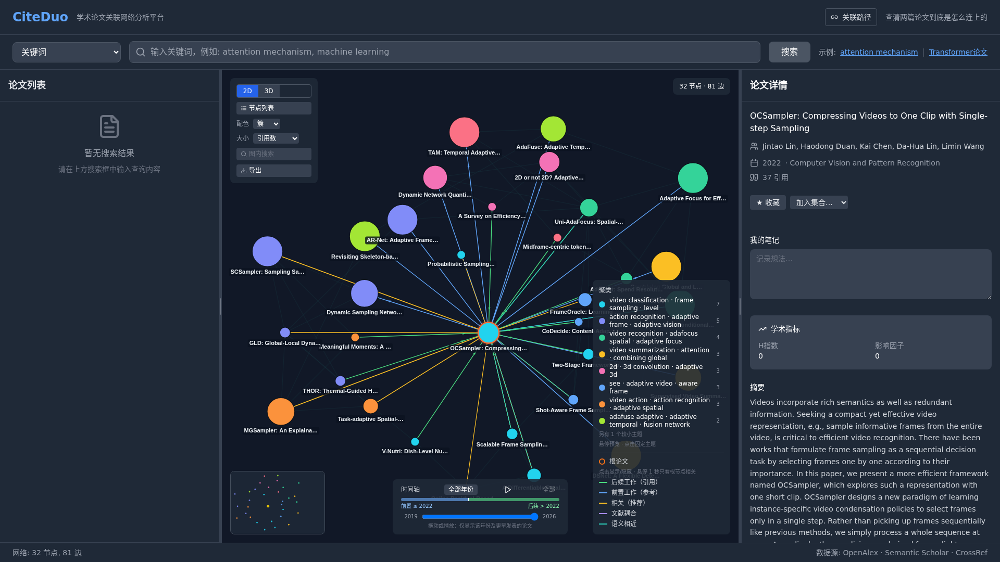

# 我在引文图里指了一条线，导师问：这条线是什么？

*一个只回答「这两篇论文到底什么关系」的本地工具，以及我第一版做错的地方。*

**利益相关：我是 CiteDuo 的作者，这篇文章介绍的是我自己做的工具，不是评测。** 它自托管、本地优先、MIT 开源，版本 v0.1.0，还很糙。下面写的是我为什么做它、第一版做错了什么、它现在能做什么、哪些地方还不行。

---

写文献综述的时候，我写下过这么一句：B 在 A 的基础上做了改进。

导师看了一眼，问：依据是什么？

我打开引文图，指了指它们之间那根线。两篇论文挨得很近，中间有一条连线，看上去很有说服力。

导师又问了一句：这条线是什么？

我答不上来。

那根线可能是 B 引用了 A，可能是两篇都被同一篇更早的工作引过，可能来自某个推荐算法，也可能只是两段摘要的向量碰巧离得近。**但在图上，它们长得一模一样。**

这个答不上来的时刻，是我后来做 CiteDuo 的原因。

## 邻域探索和关系判定，是两个问题

「这篇论文周围有什么」和「这两篇论文之间是什么关系」，是两种不同的提问。

前者是邻域探索：输入一篇论文，展开它引用的、引用它的、以及语义上相近的工作。这类工具已经做得很成熟，它们擅长画出一张领域地图——哪些论文聚成一团，哪些是重要的中间节点，一个方向大致是怎么长起来的。

后者是关系判定。当你手上已经有两篇论文，尤其在写综述、想写一句「B 是在 A 的基础上改进的」，你需要的不是「B 附近还有哪些论文」，而是：

- A 到底有没有被 B 引用过？
- 它们是不是共同引用了某篇关键工作？
- 有没有一条更长、但每一跳都说得出理由的引用链？
- 如果连直接引用都没有，这个「相关」是不是只是语义相似？

图上的一条线不回答这些问题。它只说明两篇论文被某种方式连起来了，没有告诉你这条线代表什么。

所以 CiteDuo 的重点不是再画一张更大的图，而是把「这两篇是怎么连上的」变成一个可以逐步核查的答案。

## 我第一版踩的坑

第一版里，我把「两篇论文摘要向量相似」和「B 引用了 A」画成了同一种边，只靠颜色深浅区分强弱。

看起来挺合理，两者都是「关系」嘛。

后来我拿一对自己熟悉的论文试了一下。图上给出三条路径，最短那条的中间节点，跟两端只有措辞上的相似。我心里清楚这条路站不住——但如果换成我不熟悉的领域，我可能就信了。

错在哪一步？我把证据类型上的差异，当成了权重问题，以为给向量相似调低一点分值就够了。可这两种关系的性质根本不同：

- B 引用了 A，是 B 的作者明确做出的判断，能支撑「B 基于 A 改进」；
- 两篇论文的摘要向量距离近，只是算法算出来的一个数，它最多提示「这两篇值得放在一起看看」。

把前者和后者画成同一种线，等于把「作者说过」和「算法觉得像」混成了一回事。

## 把「有关联」按来源拆开

改法是按来源给每种边一个基础置信度，而不是拿同一种线画完再用深浅调：

- **直接引用 / 被引**：最强的一层，因为它是一个可核验的作者行为。B 的参考文献里有 A，说明的是 A 影响了 B——方向很重要，反过来不成立。
- **文献耦合**：两篇论文引了同一批文献，说明它们的阅读范围有结构性交集。但综述型论文要小心，它引几百篇，会把大量本来无关的工作「耦合」到一起。
- **相关作品推荐**：Semantic Scholar 与 OpenAlex 给的线索，适合发现候选。
- **语义相似**：适合扩大搜索范围，不该单独拿来证明两篇论文有继承关系。

对应的基础置信度大致是：直接引用 1.0、被引 0.95、文献耦合 0.8、相关作品推荐 0.6、语义相似 0.45。

顺带说清楚：**这几个数字是我作为设计者的选择，不是实验测出来的结论。** 我没有做过大规模人工标注来校准它。它现在的用处，是帮你把说不清理由的路径排除掉，不是替你下判断。

只有一层证据也还不够——一条路径的可信度不会超过它最脆弱的那一跳。所以排序时我同时看平均分和最弱那一跳，并且把备选路径一并给出来。如果三条路径里有两条都经过同一个中间节点，这个节点大概率真的重要；如果只有一条路径能连起来，先当它是巧合。


*双论文关联分析：每条路径逐跳标出关系类型，并给出备选路径*

## 从 10 秒到 1 秒：三个跟算法无关的取舍

判断逻辑写完之后，真正卡住体验的地方，反而都不在算法。

**一是每篇论文都拉完整的被引列表。** 两篇论文要传 1.8 MB，光这一步 5.9 秒，而我实际只需要前 25 条。改成只取需要的字段之后，是 21 KB、1.1 秒。

**二是上游 429 之后的退避。** 我一开始写的是 1.2 秒、2.4 秒、4.8 秒，用户就是在那儿干等 8 秒。

**三是批量写入没有合并事务。** 几千条边逐条提交，几秒钟全耗在磁盘同步上。

三件事加起来，同一个查询从 10 到 15 秒降到 1 秒左右。想知道具体耗在哪一步，设 `CONNECT_TRACE=1` 会输出每一段的耗时（上一次核验是 2026-10-10）。

## 它后来长成了一个论文工作台

最初我只想解决两篇论文之间的关系。真正用起来才发现，读论文很少是一个孤立动作：搜到一篇，想看它的引用网络；找到第二篇，想并排比较；确认关系之后，想直接打开正文；读到某一段，又想先翻译一下。

如果每一步都要在网站、PDF 阅读器和聊天窗口之间来回切换，思路很容易断。于是这些环节被慢慢放到了一起。

### 搜索论文，展开引用网络

CiteDuo 同时查 Semantic Scholar 和 OpenAlex，按 DOI、arXiv 标识归一化，尽量避免同一篇论文在图里出现两次。网络图有 2D 和 3D 两种，节点按 PageRank 加权、按社区聚类，可以按边的类型筛选，也能拖时间轴看一个领域怎么长起来。布局会被存下来，下次打开不用重跑。


*引文网络：节点按 PageRank 加权、按社区聚类，也可以按时序回放*

### 把两篇论文放在一起比较

已经有多个候选工作时，可以把两篇左右并排打开，各自展开引用网络，也可以直接把这一对交给关联分析。比记住两个标题、来回切标签页轻松一些。


*双论文并排：两侧各自展开网络，也可以直接做关联分析*

### 在应用里读论文，而不是只看元数据

对 arXiv 论文，优先使用 HTML 正文阅读器，带章节大纲；没有 HTML 版本时退回摘要页或 PDF。阅读器里可以维护待读、在读、已读状态，记录阅读进度，也可以做高亮和批注。这些数据存在自己的实例里，不需要为了存一条笔记去登录第三方服务。

### 沉浸式双语翻译

逐段翻译、双语对照，译文可以展开或折叠。翻译既可以用你配置的 OpenAI 兼容 provider，也可以完全在浏览器里用内置的 Translator API 完成。我没有把它做成「把整篇论文变成另一篇文章」，而是让原文和译文出现在同一个阅读位置上，术语不确定时能马上回看原文。


*阅读器：章节大纲、阅读状态、高亮批注，以及逐段双语对照*

### 让 AI 先读正文，再回答问题

学术场景里，让模型凭记忆回答「这两篇论文是什么关系」挺危险——它的记忆正好落在最弱那一层，容易把「看起来像」当成「确实有」。

所以 CiteDuo 的 AI 阅读助手由本地的 `opencode` agent 驱动，回答前必须先通过论文搜索和章节读取工具检索正文，再根据检索到的内容作答，并且把「正在检索」「读取第 3 节」这样的过程流式显示出来。这不能保证答案永远正确，但至少答案应该来自你正在读的这篇论文，而不是模型模糊的记忆。

这条路要额外准备：机器上得装 `opencode` 二进制，并配置一个 OpenAI 兼容的 provider。两者缺一个，AI 相关接口返回 503，翻译和其余功能不受影响。


*AI 助手：回答前先检索正文，并把检索过程显示出来*

## 为什么本地优先，以及它不打算取代谁

我不想把它做成「注册之后才能用」的线上黑盒，所以 CiteDuo 默认是自托管、本地优先的：一个 Bun 进程，一个 SQLite 文件，不需要账号。搜索结果、论文关系、网络布局、笔记、收藏和阅读状态都留在自己的机器上。

这不一定是所有人的最佳选择。线上服务更省事，数据规模也可能更大。但如果你经常读论文，本地运行有几个实际好处：阅读记录不用交给一个不确定的服务；翻译和 AI provider 可以按自己的需要配；缓存会随着使用积累，抓过的关系不必每次重新请求；没有网络时，已有的本地关系仍然能继续探索；结果可以导出成 PNG、JSON、BibTeX、CSV，也能把当前状态通过链接分享出去。

我也很清楚这类工具已经有不少。Connected Papers、Litmaps、ResearchRabbit、Inciteful 都把论文邻域探索做得很成熟，CiteDuo 不打算替代谁，它只是从另一个角度补了一块拼图：别的工具更擅长回答「这篇论文周围有什么」，它更关心「我手上这两篇究竟怎么连上的」；别的工具通常把你带到线上服务里，它更强调跑在自己的机器上。

如果你只是想快速找几篇相似论文，它不一定是最短的路径。

## 跑起来要多久

有 Docker 的话，大约三分钟：

```bash
docker run -d --name citeduo \
  -p 8787:8787 \
  -v citeduo-data:/data \
  ghcr.io/benbenlijie/citeduo:latest
```

然后打开 `http://127.0.0.1:8787`。

想从源码跑，需要 Bun 1.3+ 和 pnpm 9，会久一点：

```bash
git clone https://github.com/benbenlijie/citeduo.git
cd citeduo
bash scripts/setup.sh
bun run build:web
bun run server
```

搜索开箱可用。配一个 Semantic Scholar API key，上游请求会顺畅一些；翻译和 AI 助手按自己的环境决定要不要配。

**想先看效果再决定装不装**，可以打开在线 Demo。它是一个快照实例，限流比本地严格，而且没有配置 LLM——所以 AI 助手和 LLM 翻译在 Demo 里是关掉的，这两块只能自己部署之后体验。

## 如果你想动手

项目还在很早期，很多接口和界面都会变，issue 和 PR 都欢迎。

后端是一个 Bun 进程加 `bun:sqlite`，前端是 React 18 / Vite 6 / TypeScript / Tailwind。整个设计的约束和取舍写在仓库的 `ARCHITECTURE.md`，开发和 CI 流程写在 `CONTRIBUTING.md`（CI 里包含 gitleaks 扫描）。

如果你不想先读懂全部代码，仓库文档里整理了一批可以从局部下手的问题，比如：

- 爬取时逐条写库应该合并成一个事务（现在几千条边逐条提交，时间都耗在磁盘同步上）；
- 给 Docker 镜像加一个 smoke test；
- 让「联网扩展」在界面上可控；
- 按论文许可决定是否提供全文。

每一条都写了具体位置和验收方式。如果你是做文献计量、信息检索或者前端可视化的，这里应该有不少可以下手的地方。

## 还有很多没解决

论文数据本身就不完整。不同数据库的覆盖范围、元数据质量和限流策略都不一样；一篇论文的参考文献列表缺失时，工具再聪明也补不出一条可靠的引用关系。冷门方向和新预印本尤其吃亏。

关系排序的权重是工程上的设计选择，没有经过大规模人工标注校准。所以我更愿意把它当成「帮你缩小范围、暴露线索」的工具，而不是替你完成文献判断。

AI 助手也一样：它能帮你定位正文、解释段落、整理思路，但重要判断仍然要回到论文原文和引用上下文里。

这些限制不会因为换一个更大的模型就消失。写出来是因为我希望使用者知道：CiteDuo 给出的不是「论文关系真相」，而是一条可以继续核查的探索路径。

## 最后

我做它并不是因为论文阅读已经有一个完美答案，而是因为自己一次次在「这两篇论文应该有关，但我说不清为什么」的地方卡住。

如果它能让你少开几个标签页，少在几个工具之间来回切换，并且在写下「这两篇论文相关」之前多拿到一点可以核查的依据，那它就已经帮上忙了。

利益相关：我是 CiteDuo 的作者。项目在 [GitHub](https://github.com/benbenlijie/citeduo)，MIT License；在线 [Demo](https://watchdeep.net/paper-demo/) 可以试用，注意上面说过的限制。如果你写综述时也遇到过「说不清依据」的那一刻，欢迎在评论里说说你是怎么处理的。
